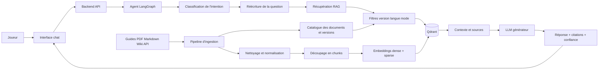

# Plan de base : architecture d'un agent RAG pour Lords Mobile

## 1. Objectif du projet

Construire un agent conversationnel spécialisé dans **Lords Mobile**. L'agent doit répondre aux questions des joueurs comme un guide fiable, contextualisé et pédagogique, en s'appuyant sur une base documentaire vérifiable plutôt que sur la mémoire générale du modèle.

L'agent devra notamment pouvoir expliquer :

- les bâtiments, recherches, troupes, héros et familiers ;
- les statistiques, bonus, contres et compositions d'armée ;
- les événements, calendriers et conditions de participation ;
- la gestion des ressources, du temps, de l'équipement et des talents ;
- les stratégies de progression pour différents profils de joueurs ;
- les étapes d'une action en jeu, avec les prérequis et les risques ;
- les différences entre versions du jeu et les informations devenues obsolètes.

Le système doit répondre comme un **assistant documentaire** : il explique, cite ses sources, signale ses incertitudes et ne présente jamais une supposition comme une règle officielle.

> Périmètre initial recommandé : conseil et guide conversationnel. Toute automatisation d'actions dans le jeu doit être traitée comme un projet séparé, soumis aux règles du jeu, à la sécurité du compte et à une validation explicite de l'utilisateur.

## 2. Principes fondamentaux du RAG

### 2.1 Pourquoi utiliser le RAG ?

Un LLM sait générer du texte, mais il ne garantit pas que ce texte soit :

- à jour avec la dernière version de Lords Mobile ;
- exact pour une statistique ou une condition précise ;
- fondé sur une source autorisée ;
- adapté au niveau et au contexte du joueur.

Le **Retrieval-Augmented Generation (RAG)** sépare donc deux responsabilités :

1. **Retrieval** : retrouver dans les documents les passages les plus pertinents pour la question.
2. **Generation** : demander au LLM de produire une réponse uniquement à partir de ces passages et de l'historique utile.

Le modèle ne remplace pas la base documentaire. Il l'interprète et la reformule.

### 2.2 Règle de grounding

Pour chaque réponse factuelle, l'agent doit suivre cette règle :

1. rechercher les preuves dans la base ;
2. vérifier que les passages concernent le bon sujet et la bonne version ;
3. répondre avec les informations retrouvées ;
4. citer la source ou le document ;
5. dire explicitement qu'il ne sait pas lorsque le contexte est insuffisant.

Une réponse sans preuve suffisante doit être une réponse prudente, par exemple :

> Je n'ai pas trouvé de source suffisamment fiable pour confirmer cette valeur. Donne-moi la version du jeu ou consulte la fiche officielle correspondante.

## 3. Architecture cible



### 3.1 Correspondance avec le projet actuel

Le dépôt fournit déjà une base réutilisable :

| Besoin | Implémentation actuelle | Adaptation Lords Mobile |
|---|---|---|
| API d'ingestion et de recherche | FastAPI dans `ai-services/rag` | Ajouter les métadonnées du jeu et les contrôles de fraîcheur |
| Base vectorielle | Qdrant | Collection dédiée, par exemple `lords_mobile_knowledge` |
| Embeddings | `Qwen/Qwen3-Embedding-0.6B` | Tester la qualité sur les termes du jeu et le multilingue |
| Recherche sémantique | Vecteurs denses | Utile pour les questions formulées naturellement |
| Recherche lexicale | Vecteurs sparse | Utile pour les noms de héros, bâtiments, troupes et valeurs exactes |
| Recherche combinée | Hybrid search avec RRF | Conserver comme mode par défaut |
| Découpage documentaire | Semantic split avec fallback récursif | Préserver les tableaux, listes et prérequis ensemble |
| Agent | Graphe LangGraph | Ajouter intention, version, langue et niveau du joueur |
| Réécriture | Deux requêtes alternatives | Ajouter synonymes et noms officiels du jeu |
| Mémoire | Checkpoints PostgreSQL | Conserver le contexte de conversation, pas les faits comme source de vérité |

## 4. Les deux pipelines à concevoir

### 4.1 Pipeline offline d'ingestion

Ce pipeline transforme les sources brutes en connaissances interrogeables.

#### Étape A : collecte

Sources possibles, classées par fiabilité :

1. documentation officielle, notes de mise à jour et annonces du développeur ;
2. données structurées vérifiées par l'équipe du projet ;
3. guides de communautés reconnues ;
4. forums, vidéos et contenus non vérifiés, uniquement comme sources secondaires.

Chaque source doit conserver son origine, sa date de collecte et sa version.

#### Étape B : normalisation

Convertir les documents en un format commun :

```json
{
  "title": "Guide des familiers",
  "text": "...",
  "source": "official-guide.pdf",
  "url": "https://...",
  "language": "fr",
  "source_type": "official",
  "game_version": "5.x",
  "published_at": "2026-01-15",
  "collected_at": "2026-09-05",
  "topics": ["familiers", "combat"],
  "reliability": 5
}
```

Nettoyer les doublons, les menus répétés, les caractères inutiles, les publicités et les fragments sans contexte. Ne pas supprimer les unités, nombres, tableaux, coûts ou conditions : ils sont souvent la partie la plus importante pour le joueur.

#### Étape C : chunking

Un chunk doit représenter une unité de sens exploitable par l'agent. Exemples :

- une fiche de bâtiment avec ses niveaux et prérequis ;
- une ligne ou un groupe cohérent d'un tableau de statistiques ;
- une étape complète d'un guide ;
- une règle d'événement avec sa condition et sa récompense.

Éviter de séparer :

- un chiffre de son unité ;
- une capacité de son héros ;
- un coût de la ressource concernée ;
- une condition de la récompense correspondante.

La taille et le chevauchement doivent être mesurés sur un jeu de questions réelles. Le `CHUNK_SIZE` du projet est un point de départ, pas une vérité universelle.

#### Étape D : enrichissement des métadonnées

Les métadonnées servent à filtrer avant la recherche ou à expliquer le résultat après la recherche. Prévoir au minimum :

```text
document_id, chunk_id, title, source, url, source_type,
language, game_version, published_at, collected_at,
topic, entity_type, entity_name, tags, reliability,
status, parent_doc_hash, chunk_index
```

`status` peut prendre les valeurs `active`, `deprecated`, `needs_review`. Une source remplacée ne doit pas être supprimée sans stratégie : elle peut rester utile pour expliquer une ancienne version, mais doit être filtrée par défaut.

#### Étape E : embeddings et indexation

Créer pour chaque chunk :

- un vecteur dense pour la similarité sémantique ;
- un vecteur sparse pour les mots et valeurs exacts ;
- une charge utile contenant le texte et les métadonnées.

La recherche hybride est importante pour Lords Mobile : une question comme « meilleur familier pour cavalerie » est sémantique, tandis que « niveau 25, 2 000 gemmes, 10 % » exige de préserver les termes et nombres exacts.

### 4.2 Pipeline online de question-réponse

1. recevoir la question et l'identité du joueur ;
2. détecter la langue et l'intention ;
3. extraire le contexte : niveau, royaume, version, héros, troupes, objectif et contraintes ;
4. reformuler la question avec les noms officiels et les synonymes ;
5. appliquer les filtres de version, langue, sujet et fiabilité ;
6. effectuer une recherche hybride avec un nombre de candidats supérieur au nombre final ;
7. reranker les candidats ;
8. supprimer les doublons et vérifier leur diversité ;
9. construire un contexte borné pour le LLM ;
10. générer une réponse structurée ;
11. rattacher chaque affirmation importante à une source ;
12. retourner la réponse, les sources, le score de confiance et les éventuelles limites.

## 5. Agent conversationnel LangGraph

### 5.1 État de l'agent

L'état de conversation devrait contenir :

```text
messages
user_profile: {language, level, play_style}
game_context: {game_version, kingdom, heroes, troops, objective}
intent
rewritten_queries
retrieved_documents
context
sources
answer_confidence
needs_clarification
```

La mémoire conversationnelle sert à comprendre « et pour la cavalerie ? » après une question précédente. Elle ne doit pas remplacer la recherche documentaire pour les faits.

### 5.2 Intentions recommandées

- `greeting` : salutation ou politesse, sans recherche coûteuse ;
- `fact_lookup` : obtenir une statistique ou une définition ;
- `how_to` : expliquer une procédure ;
- `recommendation` : comparer plusieurs choix avec les contraintes du joueur ;
- `comparison` : mettre deux objets, héros ou compositions en parallèle ;
- `event` : répondre sur un événement limité dans le temps ;
- `troubleshooting` : comprendre un résultat inattendu ;
- `unclear` : demander une précision ;
- `out_of_scope` : refuser poliment les sujets sans rapport.

### 5.3 Routage proposé

```text
classify
  -> greeting -> generate_short_answer
  -> unclear -> ask_clarification
  -> out_of_scope -> refuse_with_scope
  -> autres -> extract_context
                 -> rewrite_query
                 -> retrieve
                 -> rerank_and_validate
                 -> generate
                 -> cite_and_format
```

Une recommandation ne doit pas être traitée comme une simple recherche de fait. L'agent doit d'abord identifier les contraintes : niveau du joueur, ressources disponibles, objectif, style de jeu et horizon temporel.

## 6. Stratégie de recherche

### 6.1 Recherche hybride

Combiner la recherche dense et sparse avec une fusion de rang, comme le fait déjà le projet avec RRF. La recherche doit pouvoir recevoir des filtres :

- `game_version` ;
- `language` ;
- `topic` ou `entity_type` ;
- `source_type` ;
- `status` ;
- `reliability` minimale.

La version du jeu doit être un filtre prioritaire lorsqu'elle est connue. Si elle n'est pas connue et que plusieurs versions donnent des résultats différents, l'agent doit poser une question ou présenter clairement la différence.

### 6.2 Réécriture de requête

Pour une question joueur :

> Quel est le meilleur familier pour attaquer un château ?

Produire des variantes proches de la documentation :

- familiers bonus attaque infanterie cavalerie distance siège ;
- choix du familier pour attaque de château et composition militaire.

La réécriture ne doit jamais modifier l'intention ni inventer une contrainte absente. Conserver la question originale pour l'audit.

### 6.3 Reranking et seuil de confiance

Récupérer par exemple 20 à 50 candidats, puis ne conserver que les passages qui :

- répondent directement à la question ;
- appartiennent à la bonne version ;
- ont une qualité suffisante ;
- ne répètent pas exactement la même information.

Le score de similarité ne représente pas automatiquement la vérité. Il mesure la pertinence approximative entre une question et un chunk. Le système doit combiner plusieurs signaux : pertinence, fiabilité de la source, fraîcheur, cohérence entre sources et couverture de la question.

## 7. Contrat de réponse de l'agent

Pour une question de guide, utiliser une structure courte et régulière :

1. **Réponse directe** : la conclusion en une ou deux phrases.
2. **Pourquoi** : les éléments documentaires qui justifient cette conclusion.
3. **Étapes** : procédure numérotée si nécessaire.
4. **Attention** : prérequis, exceptions, version ou risques.
5. **Sources** : titre, URL ou identifiant du document.

Règles de génération :

- ne pas inventer une statistique absente des sources ;
- distinguer un fait documenté d'une recommandation ;
- préciser « cela dépend » lorsqu'une réponse dépend de la composition ou du niveau ;
- utiliser les unités et noms officiels ;
- ne pas surcharger une réponse simple avec tout le contexte récupéré ;
- demander une précision lorsque plusieurs interprétations sont possibles ;
- répondre dans la langue de la question, avec possibilité de changer de langue explicitement.

## 8. Gestion de la qualité et de la fraîcheur

### 8.1 Sources contradictoires

Lorsqu'un guide communautaire contredit une note officielle :

1. privilégier la source officielle la plus récente ;
2. vérifier la version associée à chaque source ;
3. exposer la contradiction si elle change la recommandation ;
4. marquer le document à revoir.

### 8.2 Obsolescence

Mettre en place un processus de mise à jour :

- collecte périodique des nouvelles notes de version ;
- détection de documents modifiés ;
- réindexation idempotente avec `content_hash` ;
- archivage des anciennes versions ;
- test automatique de questions sensibles après chaque mise à jour.

### 8.3 Validation humaine

Un administrateur doit pouvoir :

- voir les documents et leurs métadonnées ;
- retirer ou désactiver une source ;
- corriger un chunk ;
- confirmer la fiabilité d'un guide ;
- consulter les questions qui ont reçu une réponse sans preuve suffisante.

## 9. Sécurité et limites

- Valider les fichiers avant ingestion : type, taille, encodage et contenu.
- Ne jamais envoyer de secrets, tokens ou données personnelles dans les embeddings.
- Contrôler les URLs et les documents externes pour éviter l'injection de prompt.
- Considérer le texte récupéré comme une donnée non fiable, jamais comme une instruction système.
- Isoler les documents par collection ou métadonnées si plusieurs tenants existent.
- Appliquer une authentification et une autorisation aux endpoints d'administration et d'ingestion.
- Limiter la taille de l'historique et du contexte envoyé au LLM.
- Journaliser la question, les documents sélectionnés, la version du modèle et la réponse, en masquant les données personnelles.
- Ne pas automatiser une action de compte ou de jeu sans contrôle explicite et sans vérifier les règles applicables.

## 10. Évaluation

Créer un jeu de tests représentatif avant de régler les paramètres. Chaque entrée contient :

```text
question, langue, version, contexte_joueur,
réponse_attendue, sources_attendues,
niveau_de_risque, type_d_intention
```

Mesurer séparément :

### Retrieval

- `Recall@k` : la bonne source est-elle retrouvée ?
- `Precision@k` : les résultats sont-ils réellement utiles ?
- qualité du ranking après reranking ;
- taux de questions sans source adéquate ;
- fraîcheur et exactitude des métadonnées.

### Génération

- fidélité aux sources ;
- couverture des éléments attendus ;
- exactitude des chiffres et des conditions ;
- qualité des citations ;
- taux d'hallucination ;
- pertinence du niveau de détail ;
- qualité linguistique.

### Produit

- latence de la réponse ;
- coût par question ;
- taux de clarification ;
- feedback positif/négatif des joueurs ;
- taux d'escalade vers une validation humaine.

Les tests doivent couvrir les cas difficiles : question vague, faute d'orthographe, mélange français/anglais, ancienne version, source contradictoire, demande sans document, nombres précis et tentative d'injection dans un document.

## 11. Feuille de route proposée

### Phase 1 : socle documentaire

- définir les sujets Lords Mobile prioritaires ;
- sélectionner un petit corpus fiable ;
- définir le schéma de métadonnées ;
- créer la collection Qdrant dédiée ;
- ingérer PDF, Markdown et texte avec contrôle de doublons ;
- tester la recherche hybride sur des questions réelles.

### Phase 2 : guide conversationnel

- remplacer les prompts QoS par les règles Lords Mobile ;
- ajouter détection d'intention et extraction du contexte joueur ;
- ajouter les filtres de version et de langue ;
- retourner des citations propres dans l'API et le frontend ;
- implémenter la réponse prudente lorsque les preuves sont insuffisantes.

### Phase 3 : qualité et administration

- construire le dataset d'évaluation ;
- ajouter reranking, score de confiance et détection de contradiction ;
- créer l'interface de gestion du corpus ;
- automatiser l'ingestion des mises à jour ;
- ajouter les feedbacks joueurs.

### Phase 4 : recommandations personnalisées

- collecter le profil volontaire du joueur ;
- formaliser les contraintes de recommandation ;
- expliquer chaque recommandation par des sources ;
- comparer plusieurs stratégies avec leurs compromis ;
- faire valider les règles métier avant toute action externe.

### Phase 5 : fonctionnalités avancées

- recherche multimodale sur captures d'écran ;
- extraction d'informations depuis une image de rapport ou d'interface ;
- comparaison de compositions ;
- notifications sur les changements de version ;
- outils spécialisés en lecture seule pour les calculs de coûts et de temps.

## 12. Décisions initiales recommandées

1. Utiliser une collection Qdrant Lords Mobile séparée de la collection QoSentry.
2. Conserver la recherche hybride dense + sparse comme comportement par défaut.
3. Rendre `game_version`, `language`, `source_type`, `status` et `reliability` obligatoires dans le corpus officiel.
4. Afficher les sources avec chaque réponse factuelle.
5. Ne pas autoriser le LLM à déduire une statistique non présente dans le contexte.
6. Demander la version du jeu quand une réponse peut varier selon la mise à jour.
7. Commencer par un agent de guide en lecture seule avant toute intégration avec un bot ou une automatisation.
8. Évaluer le système avec des questions de joueurs avant d'optimiser le modèle ou d'augmenter la complexité du graphe.

## Conclusion

L'architecture actuelle fournit déjà un bon socle technique : FastAPI pour le service RAG, Qdrant pour la recherche hybride, embeddings denses et sparse, ingestion avec chunking, LangGraph pour l'orchestration et PostgreSQL pour les checkpoints. La transformation en guide Lords Mobile consiste principalement à construire un corpus fiable et versionné, enrichir les métadonnées, adapter les intentions et les prompts, puis mesurer systématiquement la fidélité des réponses.

Le critère de réussite n'est pas seulement que l'agent donne une réponse convaincante. Il doit donner une réponse **utile, contextualisée, à jour, explicable et vérifiable**.
